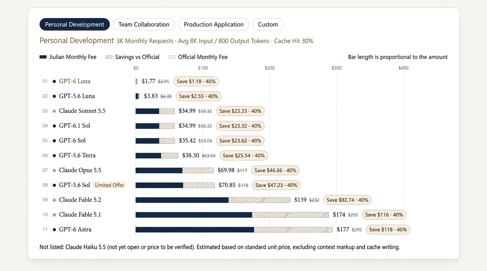

# The Cheapest GPT API Model: How 9LinkAI Sells Official Claude & GPT Tokens at 60% of List Price

*A practical, no-hype guide to 9LinkAI (9linkai.com) — the API gateway that fronts Anthropic and OpenAI's official upstream with one key, transparent per-token billing, and a flat 40% discount on every model in the catalog.*

---

If you have been hunting for the **cheapest GPT API model** — or for that matter the cheapest legitimate way to run **Claude**, Anthropic's frontier family, behind your code, your product, or your agents — you have almost certainly run into the same wall: official list prices are high, subscription plans don't map cleanly to API usage, and the gray-market "cheap API" resellers can't tell you which model is actually answering your request. 9LinkAI (久连 9Link, at 9linkai.com) is built to resolve exactly that tension for both families at once. It is an independent API relay platform: you send requests with a standard Anthropic or OpenAI-compatible endpoint, the gateway forwards each request — unchanged, un-degraded — to the official Anthropic and OpenAI upstream, and you are billed at **60% of the official public price** (official price × 0.6, a flat 40% saving across the entire catalog). GPT and Claude sit side by side in one catalog, behind one key, on one bill.

This article walks through the whole service: what it is, the full model-and-price table, a close look at the cheapest GPT API model on the list, an equally close look at the cheapest Claude, realistic monthly cost scenarios, setup in four steps, billing mechanics, reliability guarantees, and who the service is (and isn't) for.

> **Ready to try it? [Register on 9LinkAI and get your API key →](https://9linkai.com/register?aff=BASHIGE)**

---

## What 9LinkAI Actually Is

9LinkAI describes itself in one sentence: *an API relay platform for official Claude and GPT models, where Claude Code, Codex, and mainstream SDKs work by simply changing the base URL and key, billed at 60% of the official public price.*

Three properties define the product:

1. **Official upstream, zero substitution.** Every request is forwarded to the Anthropic or OpenAI official upstream, exactly as addressed. The site's motto on this point is blunt: *"Specify a model, get that model — this is our promise for every single request."* The gateway will not silently downgrade your call to a cheaper model, and it will not answer with a different model and bill you for the one you asked for. If a model name doesn't resolve (a `model_not_found` 404), the request stops there rather than being answered by something else.

2. **One key, every frontier model.** A single API Key reaches both families. Anthropic-protocol clients point at the bare root (`https://api.9linkai.com`); OpenAI-compatible clients point at the same domain with `/v1`. Anything that accepts a custom Base URL — Claude Code, Codex CLI, Cursor, Cline, Roo Code, official Python/Node SDKs, plain curl — plugs in without code changes.

3. **Transparent, usage-based billing.** You pay only for tokens actually consumed, itemized into input, output, cache write, and cache read. Every request's model, token counts, and cost are queryable line-by-line in the console.

It's also worth stating what it is not: 9LinkAI is an independent third party with no affiliation to Anthropic or OpenAI (and, per its FAQ, no relation to LinkAI / link-ai.tech). It doesn't sell proxy or circumvention services — it is an API metering and access service, full stop.

---

## The Full Price Table: Every Model, 9Link vs. Official



All prices are USD per 1 million tokens. The 9Link price is the official public list price × 0.6, verified against the official price pages as of 2026-10-16. Long-context tiers, "Fast" tiers, and cache read/write carry the same 40% discount.

| Model | Model ID | 9Link Price (In / Out) | Official Price (In / Out) | Saving |
| --- | --- | --- | --- | --- |
| **GPT-6 Luna** | `gpt-6-luna` | **$0.06 / $0.30** | $0.10 / $0.50 | 40% |
| GPT-5.6 Luna | `gpt-5.6-luna` | $0.12 / $0.72 | $0.20 / $1.20 | 40% |
| Claude Sonnet 5.5 | `claude-sonnet-5-5` | $1.20 / $6.00 | $2.00 / $10.00 | 40% |
| **GPT-6.1 Sol** | `gpt-6.1-sol` | **$1.20 / $6.00** | $2.00 / $10.00 | 40% |
| GPT-6 Sol | `gpt-6-sol` | $1.20 / $6.00 | $2.00 / $10.00 | 40% |
| GPT-5.6 Terra | `gpt-5.6-terra` | $1.20 / $7.20 | $2.00 / $12.00 | 40% |
| Claude Opus 5.5 | `claude-opus-5-5` | $2.40 / $12.00 | $4.00 / $20.00 | 40% |
| GPT-5.6 Sol *(limited-time price)* | `gpt-5.6-sol` | $2.40 / $12.00 | $4.00 / $20.00 | 40% |
| Claude Fable 5.2 | `claude-fable-5-2` | $4.80 / $24.00 | $8.00 / $40.00 | 40% |
| Claude Fable 5.1 | `claude-fable-5-1` | $6.00 / $30.00 | $10.00 / $50.00 | 40% |
| GPT-6 Astra | `gpt-6-astra` | $6.00 / $30.00 | $10.00 / $50.00 | 40% |
| Claude Haiku 5.5 | `claude-haiku-5-5` | *(not yet open)* | $0.10 / $0.50 (official) | — |

Cache pricing gets the same treatment — for example, cache read on Claude Sonnet 5.5 drops from $0.10 to $0.06 per 1M tokens, and on Claude Opus 5.5 from $0.20 to $0.12. Every model in the catalog supports roughly **1 million tokens of context** (1M–1.05M) with 128K output, and Anthropic's Batch API rule (standard price × 50%) still applies on top — meaning batch workloads through 9Link effectively run at 30% of official list price.

---

## Spotlight: The Cheapest GPT API Model — GPT-6 Luna at $0.06 / $0.30

Here is the headline most readers come for. The **cheapest GPT API model** on 9LinkAI is **GPT-6 Luna** (`gpt-6-luna`), priced at:

- **Input: $0.06 per 1M tokens** (official: $0.10)
- **Output: $0.30 per 1M tokens** (official: $0.50)
- **Cache read: $0.01** per 1M tokens (official: $0.01 → $0.006)
- Context: ~1.05M tokens, 128K output
- Served over `/v1/chat/completions` and `/v1/responses`

To put that in perspective: one million tokens of *output* from GPT-6 Luna costs thirty cents. Ten million tokens of input — roughly the size of a small novel, times ten — costs sixty cents. This is the tier 9Link's own Model Plaza labels **"lowest cost"**, and it's the model the platform's monthly-cost ranking puts at #1 by a wide margin.

The next rung up, **GPT-5.6 Luna** ($0.12 / $0.72), doubles capability for still-trivial cost. But the pricing tier that most teams will actually settle on for daily production work is **GPT-6.1 Sol** (`gpt-6.1-sol`) — OpenAI's mainstream balanced model, which 9Link sells at **$1.20 / $6.00**, roughly one-fifth the price of the flagship GPT-6 Astra ($6.00 / $30.00 through 9Link). In other words, 9Link's catalog spans a 100× price range *within the GPT family alone* — from $0.06 to $6.00 per million input tokens — and every rung of that ladder carries the same flat 40% discount.

**The catch — honestly stated:** the 40% discount applies to the token price; you should always confirm current numbers on the live [Model Plaza](https://9linkai.com/model-plaza), because prices track official list changes automatically. The discount is on public list prices, before tax. There is no free tier and no subscription — it's pure prepaid pay-as-you-go.

> **Start with the cheapest GPT API model: [create your 9LinkAI account →](https://9linkai.com/register?aff=BASHIGE)**

---

## Spotlight: The Cheapest Claude — Sonnet 5.5 at $1.20 / $6.00, and the Opus-Class Ladder

Claude is half the reason this platform exists, and its pricing deserves the same scrutiny. The **cheapest open Claude model** on 9LinkAI is **Claude Sonnet 5.5** (`claude-sonnet-5-5`), the tier the Model Plaza labels **"best value"**:

- **Input: $1.20 per 1M tokens** (official: $2.00)
- **Output: $6.00 per 1M tokens** (official: $10.00)
- **Cache read: $0.06** per 1M tokens (official: $0.10)
- Context: 1M tokens, 128K output
- Served over the native Anthropic protocol at `/v1/messages`

The site positions Sonnet 5.5 as *"the best balance of speed and intelligence, at half the price of Opus"* — and that description was written at official prices. Through 9Link, the gap between the balanced tier and the flagship widens further: daily work runs on Sonnet 5.5 at $1.20/$6.00, while Anthropic's official default for long coding sessions and enterprise knowledge work, **Claude Opus 5.5** (`claude-opus-5-5`), costs $2.40/$12.00 instead of $4.00/$20.00. For the heaviest reasoning and long-horizon agent tasks, **Claude Fable 5.1** (`claude-fable-5-1`) drops from $10.00/$50.00 to **$6.00/$30.00**, and the newer Fable 5.2 from $8.00/$40.00 to **$4.80/$24.00** — with cache reads on both models discounted from $0.25/$0.20 down to $0.15/$0.12 per million tokens.

For Claude Code users this compounds quickly, because agentic coding is cache-intensive: the same large codebase context gets replayed on nearly every turn, and at 9Link's cache-read price of $0.06 per 1M tokens on Sonnet 5.5, the repeated context that dominates an agent's token spend costs 40% less on every single turn. That's why the monthly bill for a Sonnet 5.5 agent workload in the cost simulator falls from $1,356 to $813.60 — the discount applies to the tokens agents actually burn most.

And if the official **Claude Haiku 5.5** (`claude-haiku-5-5`, listed at $0.10/$0.30 official) opens up on 9Link — the catalog already lists it as "coming soon" — it would give the Claude family its own ultra-low-cost rung to stand next to GPT-6 Luna. The catalog notes it is not yet open, so treat that as a watch item rather than an available option.

The practical takeaway: whichever family you anchor on, the ladder shape is the same — a flagship at $6.00/$30.00 (Fable 5.1 or GPT-6 Astra), a production workhorse at $1.20/$6.00 (Sonnet 5.5 or GPT-6.1 Sol), and the same flat 40% off at every rung, all reachable with one key.

> **Running Claude Code? [Get a discounted Claude API key on 9LinkAI →](https://9linkai.com/register?aff=BASHIGE)**

---

## What the 40% Discount Looks Like in Real Monthly Bills


The Model Plaza includes a cost simulator. The headline scenario is **team collaboration: 60,000 requests per month, averaging 12K input / 1K output tokens per request, 50% cache hit rate**. Ranked by monthly bill on 9Link:

| Rank | Model | 9Link Monthly Bill | Official Monthly Bill | Monthly Saving |
| --- | --- | --- | --- | --- |
| 01 | GPT-6 Luna | **$41.76** | $69.60 | $27.84 |
| 02 | GPT-5.6 Luna | $90.72 | $151.20 | $60.48 |
| 03 | Claude Sonnet 5.5 | $813.60 | $1,356.00 | $542.40 |
| 04 | GPT-6.1 Sol | $813.60 | $1,356.00 | $542.40 |
| 05 | GPT-6 Sol | $835.20 | $1,392.00 | $557.04 |
| 06 | GPT-5.6 Terra | $907.20 | $1,512.00 | $604.80 |
| 07 | Claude Opus 5.5 | $1,627.20 | $2,712.00 | $1,084.80 |
| 08 | GPT-5.6 Sol *(limited-time)* | $1,670.40 | $2,784.00 | $1,113.60 |
| 09 | Claude Fable 5.2 | $3,211.20 | $5,352.00 | $2,140.80 |
| 10 | Claude Fable 5.1 | $4,014.00 | $6,690.00 | $2,676.00 |
| 11 | GPT-6 Astra | $4,176.00 | $6,960.00 | $2,784.00 |

Read that middle of the table again: a full **Claude Sonnet 5.5– or GPT-6.1 Sol–class production workload for $813.60/month instead of $1,356.00** — $542.40 back in your pocket every month, $6,508.80 per year, from a single model choice. The Claude family scales the same way: Opus 5.5 at the same volume bills $1,627.20 instead of $2,712.00 (saving $13,017.60 a year), and Fable 5.1 bills $4,014.00 instead of $6,690.00 (saving $32,112.00 a year). Run the flagship GPT-6 Astra and the annual saving crosses **$33,000**. The discount percentage is always 40%; the absolute dollars scale with your ambition — on both sides of the catalog.

For lighter use, the math is friendlier still. 9Link charges only for what you actually burn: **no minimum top-up, no monthly fee, no expiring balance** (except promotional credits, which have their own expiry and are consumed before your principal). A hobbyist spending $20 a year on the cheapest GPT API model — or on discounted Claude Sonnet 5.5 — gets the same 40% off as an enterprise spending $20,000 a month.

> **See the numbers for yourself: [sign up free and check the live price table →](https://9linkai.com/register?aff=BASHIGE)**

---

## One Integration, Every Tool: How Setup Works

The guide promises "four steps, about five minutes," and the mechanics bear that out:

1. **Register an account** — email verification, then the console shows balance, keys, and usage at a glance.
2. **Top up the balance** — prepaid, denominated in RMB, no minimum amount. USD list prices are converted at the ledger rate (1 USD ≈ ¥6.90), the same rate used for both charging and deductions.
3. **Create an API key** — per-project or per-member keys, each with its own quota cap, spending limits (5-hour / daily / 7-day), validity window, and IP allowlist.
4. **Configure your client** — two environment variables and you're live:

```bash
# Claude Code / Anthropic SDK
export ANTHROPIC_BASE_URL="https://api.9linkai.com"
export ANTHROPIC_AUTH_TOKEN="sk-••••••••••••"

# Codex CLI / OpenAI SDK
export OPENAI_BASE_URL="https://api.9linkai.com/v1"
export OPENAI_API_KEY="sk-••••••••••••"
```

For Codex CLI, you add one model provider to `~/.codex/config.toml` (`base_url = "https://api.9linkai.com/v1"`, `wire_api = "responses"`). For Cursor, Cline, Roo Code, and any other OpenAI- or Anthropic-compatible tool, the recipe is the same: pick the provider type, paste the matching Base URL above, paste your key, and use the model IDs from the table (e.g., `gpt-6-luna`, `claude-sonnet-5-5`). A `GET /v1/models` call lists exactly which models your key can reach. If you'd rather not hand-edit config files, the console's "Use this key" button generates ready-made configuration for each supported client — and there's a native **9Link desktop client** (macOS + Windows, v0.2.1) that switches Claude Code and Codex over to 9Link with one click after a single login.

Notably, because it's a pass-through gateway, streaming output, tool/function calling, and long-context behavior are provided at full capability for whichever model you select. Model iterations change the models; the integration itself doesn't change.

> **Five minutes from now you could be running: [register → top up → create a key → connect](https://9linkai.com/register?aff=BASHIGE)**

---

## Billing Mechanics: The Details That Make the Price Trustworthy


Discounted prices are only worth something if the meter behind them is honest. 9Link's billing page specifies:

- **Itemized token billing.** Input, output, cache write, and cache read are billed separately; you pay only for real consumption. The console's usage log shows model, tokens, and cost for every individual request.
- **RMB settlement with a published rate.** Balances and deductions are in RMB, converted from the USD list price at the ledger rate (1 USD ≈ ¥6.90) — the same rate on both the top-up page and the deduction side, so there's no hidden spread between what you deposit and what you're charged.
- **Balance never expires.** Deposited principal has no validity period.
- **One consistent formula.** 9Link price = official public price × discount, currently 0.6 across the board, including official tiering (long-context pricing, Fast tiers) and cache read/write. Batch processing stays at the official rule of 50% of standard price.
- **Refund path.** Unused, paid balance is refundable on request through support (promotional credits excluded).

If anything goes wrong mid-request, the gateway publishes a complete **error-code taxonomy** — from `model_not_found` and local concurrency limits through `upstream_overloaded` (HTTP 529), stream interruptions, and client-side disconnects — with stable `[code: ...]` suffixes so your retry logic keys on codes, not prose. Failed requests are logged in "Usage → Error requests" and translated into plain-language explanations. One honesty note worth flagging: if your *client* drops the connection mid-stream (`client_disconnect`), the gateway still reads the upstream response to completion for metering purposes, so such requests are billed at full usage even if the output never fully reached you.

---

## Reliability posture: built for production

Beyond pricing, the platform's design choices read like a reliability checklist:

- **Automatic upstream failover.** On upstream rate limits or overload (529), the system briefly cools down the affected account and reschedules the request onto another available one, honoring `Retry-After` headers for backoff.
- **No silent fallback.** A missing model is a clean 404 — never a substitute model answering (and billing) in its place.
- **Request-level observability.** Every call's model, usage, and cost is queryable line-by-line.
- **Key-level blast-radius control.** Per-key quotas, spending windows, expiry, and IP allowlists mean a leaked key affects one key, not the account. (And a leaked key is one click away from revocation in the console.)
- **Security basics.** TLS throughout, salted-hashed passwords, encrypted 2FA secrets, least-privilege internal access; prompt/completion content is *not* retained as business data — only usage metadata.

For teams, the Enterprise tier layers on per-member keys, permission management, shared budgets with per-member limits and balance alerts, complete usage exports with monthly reconciliation and unified invoicing, dedicated capacity and concurrency policy, and an accountable contact with incident response. Individual accounts get the same models and the same per-token pricing — no premium on the discount for going enterprise.

---

## Who Should (and Shouldn't) Use It

**A strong fit if you:**

- Want the **cheapest GPT API model** access that still comes from the real OpenAI upstream — or equally, discounted Claude Sonnet/Opus/Fable access from the real Anthropic upstream — with prices you can verify against official list prices line by line.
- Live in **Claude Code** day-to-day: two environment variables (`ANTHROPIC_BASE_URL` + `ANTHROPIC_AUTH_TOKEN`) put Sonnet 5.5, Opus 5.5, and Fable 5.x behind your terminal at 40% off, cache reads included — the workload where Claude's savings compound fastest.
- Run Codex CLI, Cursor, Cline, or custom SDK code and want a 40% cut in your bill without touching application logic.
- Need both Anthropic and OpenAI models behind one key, one console, one bill — for example, Claude for coding agents and GPT for cheap high-volume chat, without a second vendor relationship.
- Want pay-as-you-go discipline: no subscription, no minimum spend, no expiring balance.
- Are building a team's AI budget and want per-member keys, quotas, and reconciliation.

**Know the caveats if you:**

- Need a *contractual* guarantee from OpenAI/Anthropic — 9Link is an independent intermediary, and its terms of service explicitly pass upstream availability risk through (outages or degradations caused by upstream providers are not its liability, though it will attempt failover and recovery).
- Require signed/notarized desktop software — the 9Link client is currently unsigned, so first launch requires the usual "open anyway" confirmation on macOS and Windows.
- Plan to resell API access — resale requires prior written consent.
- Are outside the intended audience: the platform settles in RMB, targets developers 18+, and is not a proxy or circumvention service.

---

## The Bottom Line

There are two ways to chase the cheapest GPT API model — or the cheapest Claude: gamble on anonymous resellers whose meters you can't audit, or take the official price and pay it in full. 9LinkAI carves out a defensible middle path: **official upstream fidelity** (no model substitution, per-request model/usage/cost auditability) at **a flat 60% of list price**, applied uniformly across both families. On the GPT side, that runs from the cheapest GPT API model in the catalog — GPT-6 Luna at $0.06/$0.30 per million tokens — up to flagship GPT-6 Astra at $6.00/$30.00. On the Claude side, it takes Sonnet 5.5 from $2.00/$10.00 down to $1.20/$6.00, Opus 5.5 to $2.40/$12.00, and Fable 5.1 to $6.00/$30.00. Add itemized cache-aware billing, per-key spending controls, one-key multi-vendor access, and a five-minute integration, and the pitch holds together for whichever family you anchor on: same models, same behavior, 40% smaller invoice.

Getting started takes an email, a top-up of any size, and two environment variables:

> ### 👉 [Register on 9LinkAI & get your API key now →](https://9linkai.com/register?aff=BASHIGE)

- **Register & get an API Key:** [9linkai.com/register?aff=BASHIGE](https://9linkai.com/register?aff=BASHIGE)
- **Full price list:** [9linkai.com/model-plaza](https://9linkai.com/model-plaza)
- **Integration guide:** [9linkai.com/guide](https://9linkai.com/guide)
- **Support:** support@9linkai.com · Telegram: t.me/Tom9linkai

*Prices and model availability cited in this article reflect the platform's published catalog verified against official price pages as of 2026-10-16; both can change, so confirm live numbers on the Model Plaza before committing a budget. 9LinkAI is an independent third-party service, unaffiliated with and unendorsed by Anthropic or OpenAI; Claude and Anthropic are trademarks of Anthropic PBC, and GPT is a trademark of OpenAI.*
